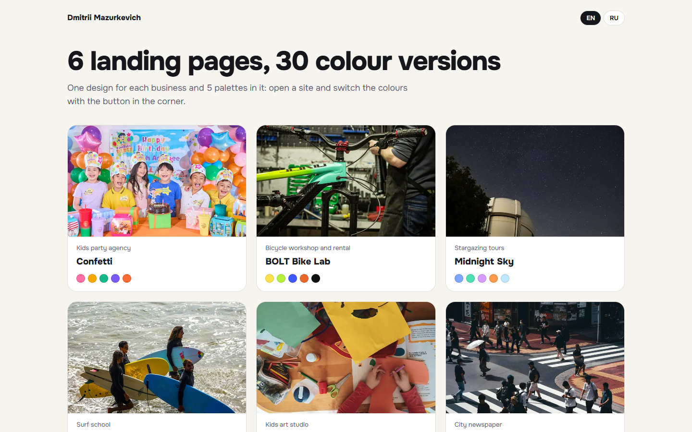

# 6 landing pages, 30 colour versions

Landing pages for a party agency, a bike workshop, stargazing tours, a surf school, a kids art studio and a city newspaper. Each has 5 colour palettes switched by a button on the page.

**Live:** https://dmitrii-mazurkevich.github.io/landing-page-designs/

## Inside

- [Balloons that pop and 5 colour palettes](https://dmitrii-mazurkevich.github.io/landing-page-designs/party/index.html): landing page for a kids party agency
- [Bold brutalism with a price list and booking](https://dmitrii-mazurkevich.github.io/landing-page-designs/bikes/index.html): landing page for a bike workshop
- [A night sky with twinkling stars in 5 palettes](https://dmitrii-mazurkevich.github.io/landing-page-designs/stars/index.html): landing page for stargazing tours
- [Waves between blocks and soft organic shapes](https://dmitrii-mazurkevich.github.io/landing-page-designs/surf/index.html): landing page for a surf school
- [Soft pastel with a schedule and trial booking](https://dmitrii-mazurkevich.github.io/landing-page-designs/kids/index.html): landing page for a kids art studio
- [Newspaper layout: lead story, columns, newsletter](https://dmitrii-mazurkevich.github.io/landing-page-designs/gazette/index.html): news site of a city newspaper

## Built with

HTML, CSS, JavaScript. Static site without a build step: open `index.html` or publish the folder to any hosting.
English and Russian versions with a language switcher, layout for phones and desktops.

## Author

Made by Dmitrii Mazurkevich: websites, WordPress and WooCommerce, analytics and AI automation.
Telegram https://t.me/dmitrii_pjm · dmitrymazurkevichse@gmail.com · [all works](https://dmitriiwebcraft.com)
